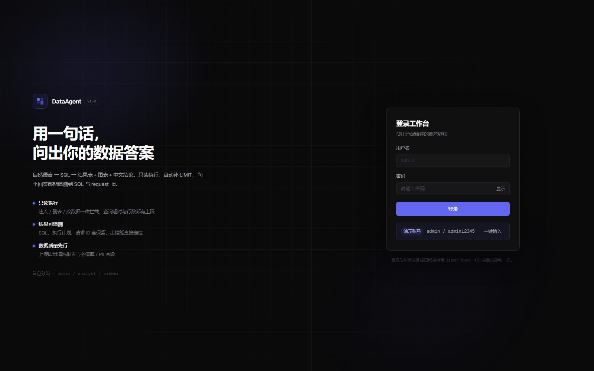
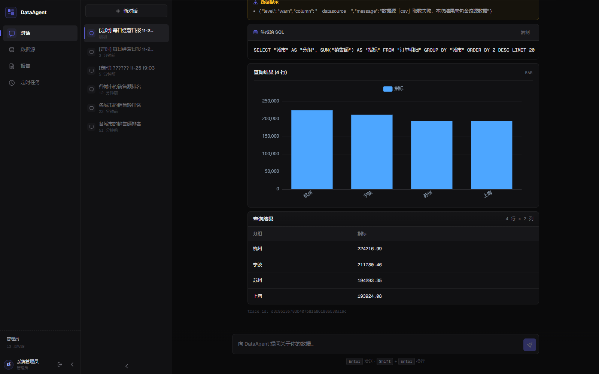
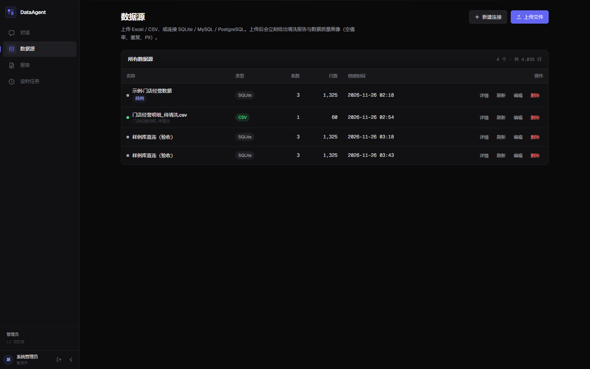
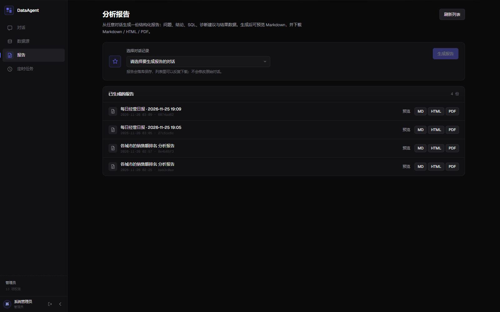

# 对话式数据分析 Agent

> 面向中小工厂 / 电商商家的自然语言数据分析助手：**一句中文问题 → 只读 SQL → 图表 → 说人话的结论**，
> 并且能说清结论是从哪几行数据来的。

[](https://github.com/xlyy1/data-analysis-agent/actions/workflows/ci.yml)


---

## 30 秒看懂

```
"2026年各城市的销售额排名"
        │
        ▼
┌──────────────────────────────────────────────────────────────┐
│ 理解意图 → 生成 SQL → 只读校验 → 执行 → 分析 → 诊断 → 图表 → 回答 │  LangGraph 8 节点
└──────────────────────────────────────────────────────────────┘
        │
        ├── SQL：SELECT "城市", SUM("销售额") FROM "订单明细" GROUP BY 1 LIMIT 1000
        ├── 表格：4 行 × 2 列（杭州 / 苏州 / 宁波 / 上海）
        ├── 图表：ECharts 柱状图配置
        └── 结论：杭州最高 18.2 万，宁波最低 4.6 万，差距主要来自线下门店覆盖…
```

**它不是"聊天框 + 随便写条 SQL"**，而是把三件容易被忽略的事做扎实了：

1. **安全**：SQL 在**执行侧**过只读闸（不是靠提示词），写操作 / 多语句 / 超长 / 危险函数全部拒绝；
2. **可信**：0 行结果明确说"没有数据"，部分数据源失败明确说"本次不含 X 源"，结果被截断明确说"只展示前 N 行"；
3. **可交付**：JWT + 三角色权限、数据源 CRUD、SSE 流式、报告落库、定时分析、`/metrics`、CI。

---

## 界面

| 登录 | 对话（SQL + 图表 + 数据表） |
|---|---|
|  |  |

| 数据源（清洗报告 + 画像） | 报告 / 定时任务 |
|---|---|
|  |  |

> 对话页那张是**真实 DeepSeek** 跑出来的（SQL 带日期过滤、答案含排名表与对比分析）；
> 其余页面来自 Docker 栈（含上传的 CSV 与定时任务历史）。演示问题请带时间范围
> （如"2026年各城市的销售额排名"），否则按 PRD 会先反问时间段。

---

## 快速开始

### 方式一：Docker（推荐，一条命令）

```bash
docker compose up -d --build --wait
# 打开 http://localhost:8080
```

首次启动会自动：建库 → 跑 Alembic 迁移 → 创建管理员 → 生成并注册一份样例数据
（4 城市 × 3 渠道 × 5 产品，1200 行订单）。

| | |
|---|---|
| 地址 | http://localhost:8080 |
| 账号 | `admin` / `admin12345` |
| API 文档 | http://localhost:8000/docs |

默认 `LLM_PROVIDER=mock`：**不填任何 API Key 也能把整条链路点通**（用于演示/CI）。
要看真实模型效果：

```bash
# .env
LLM_PROVIDER=deepseek
DEEPSEEK_API_KEY=sk-...
docker compose up -d --build
```

> ⚠️ `docker compose` 会自动读取仓库根的 `.env` 做变量替换，因此
> `docker compose config` / `docker inspect` 会**明文回显** `DEEPSEEK_API_KEY`。
> 贴日志、截图或接进 CI 之前，确认这些命令不会把 Key 打出来；用 mock 时请把 Key 清空。

### 方式二：本地开发

```bash
cp .env.example .env            # 默认 mock，不填 Key
cd backend && pip install -r requirements.txt
uvicorn worker_service.main:app --port 8001   # 任务队列 + 定时调度
uvicorn app.main:app --port 8000             # API
cd frontend && npm install && npm run dev    # http://localhost:5199
```

Windows 也可以直接双击 `start.bat`（会拉起三个进程）。

---

### ⚠️ 部署前必须改的三处（默认值写在仓库里，公开可见）

| 配置 | 默认值 | 风险 |
|---|---|---|
| `AUTH_SECRET_KEY` | `dev-only-change-me-in-production` | 用它签发的 JWT 可被伪造 → 换随机串 |
| `BOOTSTRAP_ADMIN_PASSWORD` | `admin12345` | 仓库公开 = 管理员口令公开（演示账号仅限本地） |
| `CORS_ORIGINS` | `*` | 任意站点可跨域调接口 → 生产写具体域名 |

```bash
# 生成密钥
python -c "import secrets;print(secrets.token_urlsafe(48))"
```

**仓库里不含真实凭据**：`.env` 从未被提交（全历史扫描过），`.env.example` 所有 Key 字段为空，
`data/` 被 gitignore。用 Docker 时 Compose 只从 `LLM_API_KEY` 取模型 Key（不引用 `DEEPSEEK_API_KEY`），
避免 `docker compose config` 回显宿主的真实 Key。

---

## 核心能力

| 能力 | 实现 | 证据 |
|---|---|---|
| 自然语言 → 只读 SQL | 8 节点 LangGraph，schema linking（`relations`/`column_lookup`/`sample_values`） | `backend/app/agent/graph.py` |
| 模糊问题主动澄清 | 意图节点缺指标/时间/粒度即反问，给出可点选项 | `tests/test_agent_graph_mock.py` |
| SQL 安全闸 | 只读 / 单语句 / 长度 / 危险函数 / 自动 LIMIT / 单元格上限 | `app/services/sql_policy.py`，7 类攻击全部拦截 |
| 数据接入 | Excel/CSV（清洗 + 落库 + 增量去重）、SQLite/MySQL/PostgreSQL | `app/services/ingest.py` |
| 数据画像 | 缺失率 / 唯一性 / TOP 值 / PII 标记 / 重复组 | `app/services/profiling.py` |
| 认证与权限 | JWT + refresh 轮换 + PBKDF2；admin / analyst / viewer | `app/services/auth.py` |
| SSE 流式 | 节点级进度 + 文本增量 + 元数据 | `POST /api/conversations/chat/stream` |
| 报告 | markdown / html / pdf，落库可重复下载 | `app/api/report.py` |
| 定时分析 | 唯一约束幂等 + 失败隔离 + 连续失败自动停用 | `app/services/scheduler.py` |
| 可观测 | JSON 日志 + `request_id` + `/healthz` `/readyz` `/metrics` + 审计表 | `app/observability/` |

---

## 关键数字（都有出处）

| 指标 | 数值 | 出处 |
|---|---|---|
| NL2SQL 正确率 | **100%**（309 条用例，5 套数据，含 2 套未参与调参的留出集） | `backend/bench/README.md` |
| SQL 可执行率 | 100% | 同上 |
| 平均生成延迟 | 1.5–2.1 s（DeepSeek，temperature=0） | 同上 |
| 上下文压缩后事实留存 | 100%（token 压到 31.2%） | `bench/retention_hybrid_24x15.json` |
| 后端测试 | **273 passed** | `cd backend && pytest -q` |
| 覆盖率 | 73%（门槛 70%） | `pytest --cov=app --cov-fail-under=70` |
| 依赖漏洞（HIGH/CRITICAL） | **0**（升级前 17 个） | `trivy fs --severity HIGH,CRITICAL --ignore-unfixed` |
| 恶意 SQL 拦截 | 7/7 | `tests/test_sql_policy.py`、`tools/smoke_e2e.py §8` |
| 端到端自检 | 45/45 | `python tools/smoke_e2e.py` |

---

## 三个"为什么"（面试常问）

**1. 为什么 SQL 安全放在执行侧，而不是提示词里？**
提示词会被注入绕过。`guard_sql()` 在 `execute_query` **执行前**做白名单判定，并且先把字符串
字面量和注释"打码"再匹配关键字 —— 所以 `WHERE note='delete me'` 不会误伤，而
`SELECT 1; DROP TABLE x` 一定会被拦。详见 [`docs/architecture.md §3.2`](docs/architecture.md)。

**2. 定时任务怎么保证不重复执行？**
不用分布式锁：`schedule_runs(schedule_id, scheduled_for)` 建唯一约束，抢到才执行；
抢不到说明别人已经抢了，顺手把 `next_run_at` 往前推一格（否则每轮都撞同一个键）。
重启重放、多副本并发都被数据库挡住。详见 [`docs/architecture.md §3.5`](docs/architecture.md)。

**3. 为什么 `mock` LLM 是正式组件？**
CI 不能依赖付费 Key，但"图路由 / JSON 解析 / SQL 闸 / 重试 / 图表生成"这些**机制**
必须有回归门。`MockLLM` 确定性输出，`bench/agent_baseline.py` 逐项比对基线，
任何一项从 true 变 false 就退非 0。它**不衡量模型能力** —— 准确率看归档的 309 条真实评测。

---

## API 一览

```bash
# 登录
curl -s -X POST localhost:8000/api/auth/login \
  -H 'Content-Type: application/json' \
  -d '{"username":"admin","password":"admin12345"}'

# 提问（非流式）
curl -s -X POST localhost:8000/api/conversations/chat \
  -H "Authorization: Bearer $TOKEN" -H 'Content-Type: application/json' \
  -d '{"message":"2026年各城市的销售额排名"}'

# SSE 流式
curl -N -X POST localhost:8000/api/conversations/chat/stream \
  -H "Authorization: Bearer $TOKEN" -H 'Content-Type: application/json' \
  -d '{"message":"各渠道销售额占比"}'

# 上传并清洗 Excel/CSV
curl -s -X POST localhost:8000/api/datasources/upload \
  -H "Authorization: Bearer $TOKEN" -F 'file=@data/samples/门店经营明细_待清洗.csv'

# SQL 安全闸（只校验、不执行）
curl -s -X POST localhost:8000/api/sql/validate \
  -H "Authorization: Bearer $TOKEN" -H 'Content-Type: application/json' \
  -d '{"sql":"DROP TABLE \"订单明细\""}'
```

完整接口见 `/docs`（OpenAPI）。错误体统一为：

```json
{"error": {"code": "forbidden", "message": "当前角色（viewer）无权执行该操作",
           "details": {"required": ["datasource:write"]}, "request_id": "…"}}
```

---

## 测试与 CI

```bash
cd backend
python -m pytest -q                        # 273 passed
python -m ruff check .                     # All checks passed
python -m pytest -q --cov=app --cov-fail-under=70
python bench/agent_baseline.py             # 机制回归基线（离线）
python bench/quality_gate.py               # 归档准确率门槛
python tools/smoke_e2e.py --base-url http://127.0.0.1:8000   # 45 项端到端自检

cd ../frontend
npm ci && npm run lint && npm run build
```

安全扫描（CI 里同样的命令）：

```bash
# 依赖漏洞：当前 0 个 HIGH/CRITICAL（升级前 17 个，用升级修掉，.trivyignore 无豁免）
trivy fs --scanners vuln --severity HIGH,CRITICAL --ignore-unfixed \
  --skip-dirs frontend/node_modules --skip-dirs frontend/dist --exit-code 1 .
pip-audit -r backend/requirements.txt   # No known vulnerabilities found

# 运行镜像的 OS 包（当前三个镜像均 0 HIGH/CRITICAL）
trivy image --severity HIGH,CRITICAL --ignore-unfixed data-agent-api:latest

# workflow 本身也用 actionlint 校验过（exit 0）
actionlint .github/workflows/ci.yml
```

CI（`.github/workflows/ci.yml`）四个 job：后端（lint + 测试 + 覆盖率 + 两个回归门）、
迁移（空库 upgrade → `alembic check` → downgrade → upgrade）、前端（lint + build）、
安全（`pip-audit` + Trivy）、容器（三个镜像可构建）。**全部离线，不碰付费 Key。**

---

## 技术栈

| 层 | 选型 | 说明 |
|---|---|---|
| 后端 | FastAPI + Pydantic v2 + SQLAlchemy 2.0 (async) | 异步链路，SSE 原生支持 |
| Agent | LangGraph + LangChain Core | 条件边表达澄清 / 确认 / 重试 / 诊断分支 |
| 模型 | DeepSeek / Ollama / OpenAI 兼容端点 / **mock** | mock 用于 CI 与离线演示 |
| 元数据库 | SQLite（WAL）+ Alembic | 单机定位；多租户换 PostgreSQL |
| 前端 | Vue 3 + TypeScript(strict) + Vite + Pinia + Vue Router | 组件自绘，理由见 `docs/architecture.md §3.10` |
| 图表 | ECharts | 后端给 `echarts_option`，前端只渲染 |
| 部署 | Docker Compose + Nginx | 三镜像 + 命名卷持久化 |

> 审计时 TDesign 虽在依赖里但没有任何组件使用（只做了全局注册）。本次补齐前端时将其移除，
> 理由与"如何加回来"写在 [`docs/architecture.md §3.10`](docs/architecture.md)。

---

## 项目结构

```
backend/
  app/
    agent/         LangGraph 图与 8 个节点
    api/           路由（auth / conversation / datasource / report / schedules / sql / system）
    datasource/    连接器（sqlite / mysql / postgres / excel+csv）
    llm/           LLM 抽象（deepseek / ollama / openai / mock）
    models/        SQLAlchemy 模型（统一导出给迁移用）
    services/      业务逻辑（ingest / profiling / schema / sql_policy / scheduler / report …）
    observability/ trace / 结构化日志 / 指标
  alembic/         数据库迁移
  bench/           评测与回归门
  tests/           273 个测试
  tools/           smoke_e2e.py 等
frontend/          Vue3 + TDesign + ECharts（Nginx 托管）
docs/              audit / architecture / PRD / demo / alerts / pitch
```

---

## 文档

| 文档 | 内容 |
|---|---|
| [`docs/audit.md`](docs/audit.md) | 接手时的审计：基线、10 个模块的缺口、取舍、剩余风险 |
| [`docs/architecture.md`](docs/architecture.md) | 架构图、请求链路、**9 个关键技术取舍**、单机/多副本边界 |
| [`docs/PRD.md`](docs/PRD.md) | 需求、角色、非功能指标、4 个验收场景 |
| [`docs/demo.md`](docs/demo.md) | 验收记录：每条命令的实际输出 |
| [`docs/pitch.md`](docs/pitch.md) | 5 分钟讲解稿 + 3 条简历要点 |
| [`docs/alerts.md`](docs/alerts.md) | 指标清单、Prometheus 告警规则、排障路径 |
| [`backend/bench/README.md`](backend/bench/README.md) | 所有评测的口径与数字 |

---

## 已知边界（不打算"修"的部分）

| 边界 | 说明 |
|---|---|
| 元数据库是 SQLite | 面向单机私有化；api + worker 共享一个文件，靠 WAL + `busy_timeout` 扛。多租户应换 PostgreSQL |
| 限流是进程内的 | 多副本时总量放大 N 倍，精确限流需要 Redis |
| 任务队列是进程内的 | 没有跨进程抢占锁；靠"落库 + 重启恢复"兜底，定位就是单机 |
| 调度器没有领导者选举 | 靠 `schedule_runs` 唯一约束保证幂等，不是真分布式调度 |
| `mock` 模型不衡量质量 | 它只保证链路通；真实效果必须用 DeepSeek/Ollama 实测 |
| PDF 中文依赖系统字体 | 容器内已装 `fonts-noto-cjk`；本地未装时退化为 ASCII |

这些取舍的理由写在 [`docs/architecture.md §5`](docs/architecture.md)。

## License

[MIT](LICENSE)
